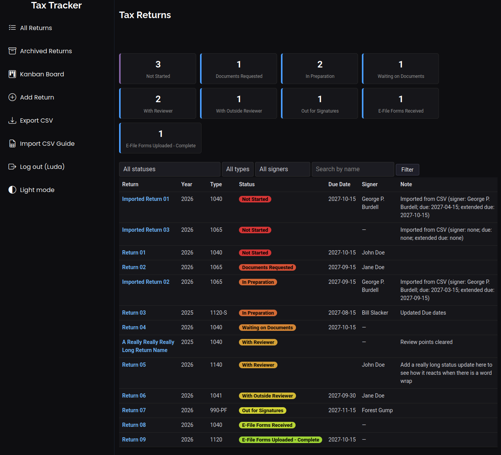
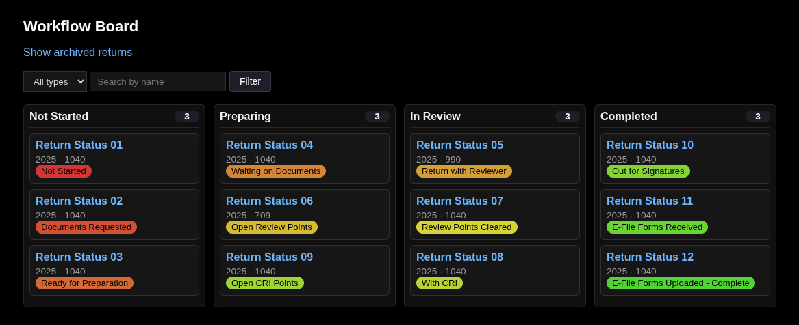
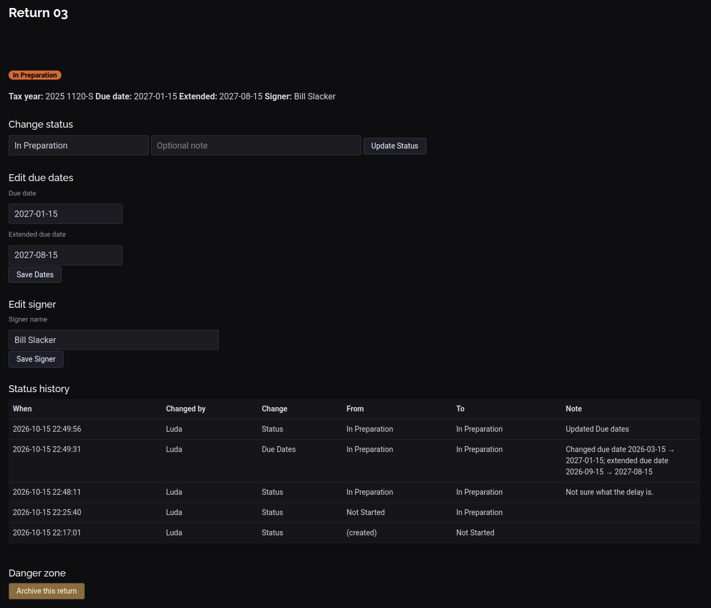
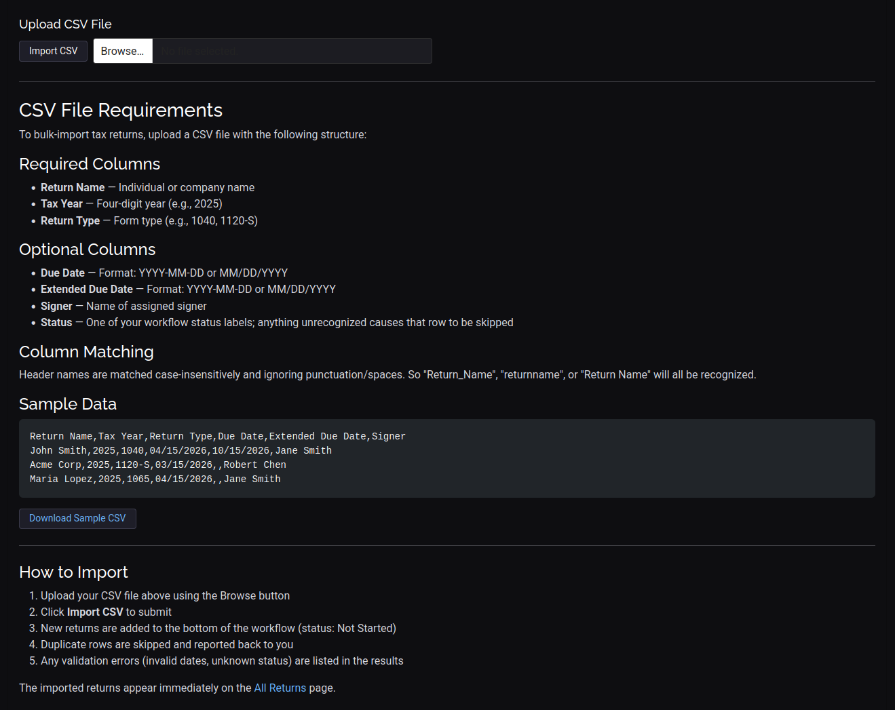

# Tax Return Status Tracker

[](https://github.com/Lawyneer/return_tracker/actions/workflows/ci.yml)

A lightweight, single-database web application for tracking the status
of tax returns through not started all the way completion via e-file
confirmation. Built with Flask and SQLite and designed for small firms or
teams that want a shared checklist-style tracker with a full audit trail.

## Features

- **Workflow stage tracking** — return status progresses through various
  workflow stages (configurable per deployment), with dashboard counts,
  a kanban board, and filtering by any combination of status, return type,
  and signer.
- **Signer tracking** — each return records a signer (set at creation or any
  time later), shown on the list, board, and detail pages, filterable in both
  views, and included in the CSV export
- **Full audit trail** — every status change *and every signer or due-date
  edit* is timestamped, attributed to a user, and labeled by change type,
  with optional notes on status changes
- **Dashboard overview** — at-a-glance count of returns in each workflow stage
- **Kanban workflow board** — a board view grouping active returns into
  four columns (Not Started, Preparing, In Review, Completed) with
  per-column counts, filterable by return type and signer, searchable by name
- **Overdue highlighting** — returns past their effective due date (extended due
  date if set) are flagged automatically
- **Soft archiving** — completed returns can be archived and later restored,
  with history preserved
- **Filtering & search** — filter by status, return type, or signer, plus
  search by name
- **CSV export** — download active or archived returns as a spreadsheet,
  including the signer
- **CSV import** — bulk-add returns from a spreadsheet; only Return Name,
  Tax Year, and Return Type are required (see
  [CSV Import](#csv-import)); a ready-to-edit template ships with the repo
  (`import_template.csv`)
  - **Import CSV Guide page** — the upload form and complete format
  documentation live on a dedicated "Import CSV Guide" page reachable
  from the sidebar, with a downloadable sample file
- **Dual themes** — dark mode (default) and light mode
- **Tested** — pytest suite covering login, the audit trail (status changes
  and signer/due-date edits), signer handling, CSV import and export,
  archiving, and filtering, run automatically in CI
- **Zero external services** — single SQLite database file, no server setup,
  no accounts or passwords to manage (a password login is planned, see [Roadmap](#roadmap))

## Screenshots

### Dashboard Overview



The dashboard provides at-a-glance status counts for each workflow stage, followed by a filterable table view of all active returns.

### Workflow Board (Kanban View)



The kanban board groups active returns into four columns — Not Started, Preparing, In Review, Completed — with per-column counts, clickable cards, and filtering by return type and signer.

### Return Detail Page



Each return's detail page includes status change controls, due date and signer editing, the full audit history, and archiving options. The status dropdown pre-selects the current status for note-only updates.

### Import CSV Guide



The Import CSV Guide page pairs the bulk-upload form with complete documentation of the expected file format — required and optional columns, accepted date formats, and header-matching rules — along with a downloadable sample file to start from.

## Supported Return Types

1040, 1041, 1065, 1120, 1120-S, 990, 990-PF, 990-T, 706, 709, State, Other

## Project Structure

```text
return_tracker/
├── .github/
│   └── workflows/
│       └── ci.yml          # GitHub Actions: pytest on Python 3.10–3.12
├── templates/
│   ├── base.html
│   ├── board.html
│   ├── detail.html
│   ├── import_info.html    # Import CSV Guide (upload form + docs)
│   ├── index.html
│   ├── login.html
│   └── new_return.html
├── static/
│   └── css/
│   |   ├── dark.css
│   │   ├── layout.css      # Structural rules (sticky footer)
│   |   ├── light.css
│   │   ├── main.css
│   |   └── sidebar.scc     # Sidebar styling (theme-independent)
│   ├── js/                 # Template JavaScript
│   └── vendor/             # Bootstrap, AOS, Bootstrap Icons, etc.
├── tests/
│   ├── conftest.py         # Shared fixtures (temp database, client, user)
│   ├── test_auth.py        # Login flow, access control, theme toggle
│   ├── test_returns.py     # Creation, validation, status changes, history, form details
│   ├── test_board.py       # Kanban board: columns, counts, filters
│   ├── test_dashboard_archive_export.py
│   └── test_signer_audit_import.py  # Signer field, change_type audit trail, CSV import
├── app.py                  # Application factory + entry point
├── auth.py                 # Blueprint: login / logout / theme toggle
├── config.py               # Configuration (secret key, DB path)
├── constants.py            # Return types and workflow status definitions
├── db.py                   # SQLite connection handling & schema
├── helpers.py              # Shared utilities, template context, Jinja filters
├── returns.py              # Blueprint: return CRUD, archive, CSV import/export
├── import_template.csv     # Sample CSV for the bulk import
├── screenshots/            # Images referenced by the README
│   ├── kanban.png
│   ├── main_page.png
│   └── detail_page.png
├── .gitattributes          # Line-ending normalization; DB treated as binary
├── CONTRIBUTING.md         # How to contribute
├── pytest.ini              # Test runner configuration
├── requirements.txt        # Runtime dependencies
├── requirements-dev.txt    # Development dependencies (pytest)
└── tax_returns.db          # SQLite database (created on first run, not committed)
```

## Getting Started

### Prerequisites

- Python 3.10+
- Flask

### Setup

**1. Create and activate a virtual environment**

Keeping dependencies in a virtual environment avoids conflicts with your
system's Python packages and makes the project portable:

```bash
# From the project root
python3 -m venv venv

# Activate it:
# Linux / macOS
source venv/bin/activate
# Windows (PowerShell)
.\venv\Scripts\Activate.ps1
```

**2. Install dependencies**

```bash
pip install -r requirements.txt
```

(For development, also install the test dependencies — see
[Testing](#testing) below.)

**3. Run the app**

```bash
python app.py
```

The app starts on `http://0.0.0.0:5000`, making it reachable from other
machines on your local network. Open `http://localhost:5000` in your browser,
add yourself as a user, and start adding returns.

To deactivate the virtual environment when you're done:

```bash
deactivate
```

### First-Time Use

1. On the login page, add your name under **Add a new user**
2. Select your name from the dropdown and sign in
3. Click **+ Add Return** to create your first tax return (optionally with a
   signer and due dates)
4. Open a return to change its status, add notes, or edit due dates and the
   signer
5. Open the **Kanban Board** from the left sidebar for the four-column
   overview of where every return stands
6. Have a spreadsheet of returns ready? Use the **Import CSV Guide**
   link in the sidebar to upload it

## CSV Import

The sidebar's **Import CSV Guide** page includes the upload form and
complete format documentation, plus a downloadable sample file.
Columns are matched by header name, case and punctuation insensitive,
and a UTF-8 BOM (typical of Excel exports) is handled automatically.

Required columns:

- **Return Name**
- **Tax Year**
- **Return Type**

Optional columns:

- **Due Date** / **Extended Due Date** — `YYYY-MM-DD` or `MM/DD/YYYY`
- **Signer** — free text
- **Status** — either the status code (`with_preparer`) or the label
  (`In Preparation`); blank defaults to "Not Started"

Rows are validated and committed individually: valid rows are inserted,
rows duplicating an existing return (same name, year, and type) are skipped,
and invalid rows are rejected with a reason. A summary at the top of the
page reports the outcome. A starter template,
[`import_template.csv`](import_template.csv), is included in the repo.

## Testing

The test suite uses pytest with an isolated, throwaway SQLite database per
test — your local `tax_returns.db` is never touched.

```bash
pip install -r requirements-dev.txt
pytest
```

The suite covers the login flow, return creation and validation, the full
status-change audit trail (who, when, and any note), backward status moves,
dashboard counting, the kanban board's column grouping and count, archiving/
restoring, filtering, and CSV export.

CI runs the suite on Python 3.10–3.12 for every push and pull request —
see the badge at the top of this page.

## Contributing

Bug reports, feature ideas, and pull requests are welcome! See
[CONTRIBUTING.md](CONTRIBUTING.md) for setup instructions, coding
guidelines, and the pull-request checklist.

## Configuration

Both settings can be overridden with environment variables:

| Setting | Default | Environment Variable |
|---|---|---|
| Secret key | Randomly generated at startup | `TAX_TRACKER_SECRET` |
| Database path | `./tax_returns.db` | `TAX_TRACKER_DB` |

Setting a fixed `TAX_TRACKER_SECRET` is recommended for production so user
sessions survive app restarts.

## Backups & Data

All data lives in a single SQLite file (`tax_returns.db`). To back up, simply
copy that file while the app is stopped. To reset, delete the file — the schema
and default statuses are recreated on next launch.

Existing databases from earlier versions of this app are migrated
automatically (`archived_at`, `signer`, and status-history `change_type`
columns are added if missing; existing history rows are back-filled as
status changes).

## Security Notes

This app uses **passwordless, name-based login**: anyone who can reach the app
can sign in as any user. It is designed for a **trusted internal network**, not
public internet exposure.

Before exposing it beyond a private LAN, consider:

- Putting it behind a VPN or reverse proxy with authentication
- Adding real password-based authentication
- Serving over HTTPS

Password authentication, login rate limiting, and CSRF protection are
planned — see [Roadmap](#roadmap). Until they ship, treat this app as
insecure on any network you don't fully control.

## Roadmap

These are the final planned features for the project — once they ship,
the app is considered feature-complete.

- **Assignment of returns to users** — assign a preparer or reviewer to
  each return, changeable during a status update or on its own, with
  every reassignment recorded in the status history
- **Pipeline statistics** — time spent at each workflow status and a
  per-user count of status moves, computed from the existing audit trail
- **Database backup download** — a consistent SQLite snapshot taken via
  SQLite's online backup API, safe to run while the app is serving requests
- **Password authentication** — replace the current passwordless,
  name-based login: passwords stored salted and hashed (Werkzeug
  PBKDF2), existing users prompted to set a password on first login
  after the upgrade
- **Login rate limiting** — temporary lockout after repeated failed
  attempts on the same username
- **CSRF protection** — token protection on all forms and hardened
  session cookies (`HttpOnly`, `SameSite=Lax`), in preparation for
  internet-facing deployments

The last three are related hardening work that would ship together, and
together they would make the app safe to expose beyond a trusted network.
Until then, the [security notes](#security-notes) apply.

See [CHANGELOG.md](CHANGELOG.md) for what has already been released.

## License

This project is licensed under the MIT License — see the
[LICENSE](LICENSE) file for details.