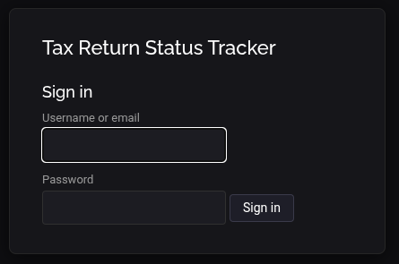

# Tax Return Status Tracker

[](https://github.com/Lawyneer/return_tracker/actions/workflows/ci.yml)

A lightweight, single-database web application for tracking the status of tax returns through preparation and review — who's working on what, where each return sits in the pipeline, what's overdue, and a complete audit trail of every change. Built for small teams (a handful of users) that need a simple, auditable pipeline view without the weight of a full practice-management platform.

## Features

- **9-stage workflow** from "Not Started" to "E-File Forms Uploaded – Complete", with free backward movement and a red-to-green status badge gradient so progress is visible at a glance.
- **Kanban board** (`/board`) grouping active returns into four workflow columns (Not Started, Preparing, In Review, Completed) with per-column counts, filterable by type, signer, and name search.
- **Full audit trail**: every status change, signer edit, and due-date edit is logged with the old/new values, who made the change, and a timestamp. The history table on each return's detail page distinguishes Status, Signer, and Due Date entries.
- **Due-date tracking** with extensions and automatic OVERDUE highlighting based on the effective (extended-if-set) due date.
- **Signer assignment** per return, with case-insensitive filtering by signer on both the list and board views.
- **Soft archive/restore** that hides a return from active views while preserving its entire history.
- **CSV export** of active or archived returns with dated filenames.
- **CSV bulk import** with forgiving header matching (case/punctuation insensitive, Excel BOM handled), per-row validation and error reporting, duplicate skipping, and status import by code or label.
- **Dark/light theme** toggle, remembered per session.
- **Security**: argon2id password hashing, enforced password policy, CSRF protection on all forms, hardened session cookies, and persistent brute-force lockout (username and IP) after five failed logins.

## Screenshots

### Dashboard Overview


The dashboard provides at-a-glance status counts for each workflow stage, followed by a filterable table view of all active returns.

### Workflow Board (Kanban View)


The kanban board groups active returns into four columns — Not Started, Preparing, In Review, Completed — with per-column counts, clickable cards, and filtering by return type and signer.

### Return Detail Page


Each return's detail page includes status change controls, due date and signer editing, the full audit history, and archiving options. The status dropdown pre-selects the current status for note-only updates.

### Import CSV Guide


The Import CSV Guide page pairs the bulk-upload form with complete documentation of the expected file format — required and optional columns, accepted date formats, and header-matching rules — along with a downloadable sample file to start from.

### Login



Sign-in requires a username (email address or alphanumeric name) and a password. Accounts are provisioned by an administrator — there is no self-registration.

## Requirements

- Python 3.10+
- A Linux/Unix host for production deployments (nginx + gunicorn + systemd, per the deployment notes below)

Runtime dependencies: Flask, Flask-WTF, argon2-cffi (see `requirements.txt`).

## Quick start (local development)

```bash
python3 -m venv venv
source venv/bin/activate
pip install -r requirements.txt -r requirements-dev.txt
export TAX_TRACKER_SECRET="any-random-string-for-local-dev"
python app.py
```

Then open http://localhost:5000.

The app refuses to start without `TAX_TRACKER_SECRET` — this is intentional, so a misconfigured deployment fails loudly instead of silently generating an insecure ephemeral key.

### Creating users

There is no self-registration. An administrator creates accounts and sets passwords via the CLI:

```bash
venv/bin/python manage_users.py add jane@example.com
```

Subcommands:

| Command | Purpose |
|---------|---------|
| `add <username>` | Create a user (prompts for a hidden password) |
| `set-password <username>` | Set/reset a password (also unlocks legacy pre-v2.0.0 users) |
| `list` | Show users and whether each has a password |
| `lock-status` | Show active lockouts and failed-attempt counters |
| `reset-lockouts` | Clear all lockouts and failure counters (admin unlock) |

Usernames are either an email address or a 3–64 character alphanumeric/underscore name. Passwords must be 20–100 characters with at least one lowercase letter, one uppercase letter, one digit, and one standard ASCII special character.

### Lockout policy

After five failed login attempts, both the affected username and the client IP are locked. Lockouts are stored in the database and survive application and server restarts; they are only cleared by an administrator running `manage_users.py reset-lockouts`. A successful login clears the user's own failure counter, but the IP counter is cumulative by design — there is no self-serve unlock path.

## Running the tests

```bash
pytest
```

Tests run against a throwaway per-test SQLite database in a temporary directory; your local data is never touched. The suite takes ~25 seconds, mostly due to real argon2 verification in the lockout tests.

## Production deployment (summary)

The supported topology is nginx (TLS termination) → gunicorn (bound to 127.0.0.1) → Flask, with gunicorn managed by systemd:

1. Install dependencies into a virtualenv, including gunicorn.
2. Generate a strong secret: `python -c "import secrets; print(secrets.token_hex(32))"` and provide it to the service via an `EnvironmentFile=` (chmod 600).
3. Create a systemd unit running: `gunicorn --workers 2 --bind 127.0.0.1:5000 "app:create_app()"` with `WorkingDirectory` set to the project directory.
4. Configure nginx to proxy the (sub)domain to 127.0.0.1:5000, passing `X-Forwarded-For` (required for correct lockout IP tracking; the app applies `ProxyFix` for a single proxy hop) and a `client_max_body_size` large enough for CSV imports (e.g., 10M).
5. Issue a TLS certificate (e.g., certbot) and serve only over HTTPS — the shipped `Config` sets `SESSION_COOKIE_SECURE`.
6. Provision users with `manage_users.py` and back up `tax_returns.db` regularly — it is the only stateful component: `sqlite3 tax_returns.db ".backup backup-$(date +%F).db"`

## Project structure
```text
return_tracker/
├── .github/
│   └── workflows/
│       └── ci.yml
├── templates/
│   ├── base.html
│   ├── board.html
│   ├── detail.html
│   ├── import_info.html
│   ├── index.html
│   ├── login.html
│   └── new_return.html
├── static/
│   ├── css/
│   │   ├── dark.css
│   │   ├── layout.css
│   │   ├── light.css
│   │   ├── main.css
│   │   └── sidebar.css
│   ├── js/
│   └── vendor/             # Bootstrap, AOS, Bootstrap Icons, etc.
├── tests/
│   ├── conftest.py
│   ├── test_auth.py
│   ├── test_returns.py
│   ├── test_board.py
│   ├── test_dashboard_archive_export.py
│   ├── test_security_auth.py
│   └── test_signer_audit_import.py
├── app.py
├── auth.py
├── config.py
├── constants.py
├── db.py
├── helpers.py
├── manage_users.py
├── returns.py
├── security.py
├── import_template.csv
├── screenshots/
│   ├── kanban.png
│   ├── main_page.png
│   ├── detail_page.png
│   └── import_guide.png
├── .env                    # Local secret (never committed; gitignored)
├── .gitattributes
├── .gitignore
├── CHANGELOG.md
├── CONTRIBUTING.md
├── pytest.ini
├── requirements.txt
├── requirements-dev.txt
└── tax_returns.db
```

## Data storage

A single SQLite database (`tax_returns.db`, path overridable via `TAX_TRACKER_DB`) holds users, statuses, returns, the audit-trail history, and the lockout tables. The schema is created on first run and migrated in place (new columns added as nullable; existing data never touched).

## License

This project is licensed under the MIT License — see the
[LICENSE](LICENSE) file for details.